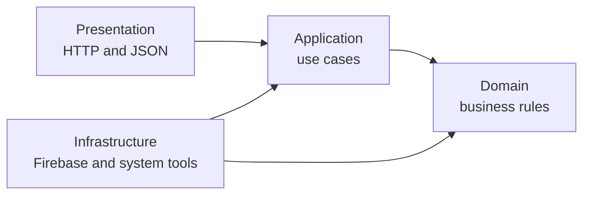

# TODO app with DDD and onion architecture

This project is a small TODO API built to explain two ideas:

- **Domain-driven design (DDD):** put business meaning and business rules in a
  clear domain model.
- **Onion architecture:** keep that model in the center and make technical code
  depend on it, rather than making the model depend on technical code.

For one standalone explanation of registration, authentication, create/get
flows, and Python debugger controls, read
[FINAL_README.md](FINAL_README.md).

The API supports full task CRUD plus completion. Firebase Authentication proves
who is calling, and Cloud Firestore stores each task with its owner's Firebase
user ID.

## Architecture at a glance

Think of the application as four rings:



- The **Domain** knows what a valid task is and how a task is completed.
- The **Application** knows which steps make up a user action such as “create a
  task.”
- **Presentation** knows HTTP, routes, request bodies, and JSON responses.
- **Infrastructure** knows Firebase, system time, UUID generation, and logging.

Dependencies point toward the center. For example,
[task_service.py](application/services/task_service.py) knows the
`TaskRepository` interface, but it does not import Firebase. The Firebase
implementation in
[firestore_task_repository.py](infrastructure/repositories/firestore_task_repository.py)
depends on the inner domain types.

## Project map

```text
DDD/
├── domain/                 Business meaning and rules
│   ├── entities/           Objects with identity
│   ├── value_objects/      Small immutable validated values
│   ├── domain_services/    Rules involving several domain objects
│   ├── domain_events/      Facts that happened in the domain
│   └── exceptions/         Broken business-rule errors
├── application/            User use cases
│   ├── services/           Use-case coordination
│   ├── dtos/               Input/output data shapes
│   ├── interfaces/         Capabilities needed from outside
│   └── exceptions/         Use-case errors
├── presentation/           HTTP input and JSON output
│   ├── routes/
│   ├── controllers/
│   ├── middleware/
│   ├── validators/
│   ├── views/
│   └── http_server.py
├── infrastructure/         Technical implementations
│   ├── firebase/
│   ├── authentication/     Firebase login/register and token verification
│   ├── repositories/
│   ├── providers/
│   ├── messaging/
│   └── config/
├── tests/
├── scripts/                Reversible operational migrations
├── postman/                Importable collection and local environment template
├── POSTMAN.md              Registration, login, and CRUD walkthrough
├── DEBUGGING.md            Request/response breakpoint walkthrough
├── bootstrap.py            Connects all dependencies
└── main.py                 Starts the application
```

Empty `__init__.py` files only make folders importable Python packages.

## API contract

Registration and login are public because the caller does not have a token yet.
Every task endpoint requires a valid Firebase ID token in
`Authorization: Bearer <ID_TOKEN>`.

| Request | Purpose | Application method | Success |
| --- | --- | --- | --- |
| `POST /auth/register` | Register with email/password | `AuthService.register()` | `201` session DTO |
| `POST /auth/login` | Authenticate email/password | `AuthService.login()` | `200` session DTO |
| `POST /tasks` | Create my task | `TaskService.create()` | `201` task DTO |
| `GET /tasks` | List my tasks | `TaskService.list_tasks()` | `200` task list |
| `GET /tasks/{id}` | Get one of my tasks | `TaskService.get()` | `200` task DTO |
| `PATCH /tasks/{id}` | Rename one of my tasks | `TaskService.update()` | `200` task DTO |
| `POST /tasks/{id}/complete` | Complete one of my tasks | `TaskService.complete()` | `200` task DTO |
| `DELETE /tasks/{id}` | Delete one of my tasks | `TaskService.delete()` | `200` deletion confirmation |

Create and rename accept exactly one JSON field:

```json
{ "title": "Learn DDD" }
```

A task response always has the same public fields:

```json
{
  "id": "task UUID",
  "title": "Learn DDD",
  "created_at": "2026-10-02T10:00:00+00:00",
  "completed_at": null
}
```

`owner_id` is deliberately absent from public responses. The server gets it
from the verified token, never from request JSON.

For the two auth requests, [auth_controller.py](presentation/controllers/auth_controller.py)
creates `RegisterUserDTO` or `LoginUserDTO`. [auth_service.py](application/services/auth_service.py)
calls the application-owned `IdentityProvider` interface, and
[firebase_auth_rest_provider.py](infrastructure/authentication/firebase_auth_rest_provider.py)
implements that interface with Firebase Auth REST. Firebase validates the
credentials and returns a session. The password is never stored or logged by
this API. The returned `id_token` is then sent as the Bearer token on task
requests.

## Domain layer: the business rules

The domain layer does not know about HTTP, JSON, Firebase, or environment
variables.

### Entity

An **entity** is an object that has an identity and can change over time.

Implemented example: [Task](domain/entities/task.py).

- Its `id` identifies the same task before and after completion.
- Its `complete()` method changes `completed_at` only once.
- Calling `complete()` again does nothing and creates no second event.

`Task` is also the **aggregate root**. In simple terms, code should change task
state through the `Task` object, especially through `Task.complete()`, instead of
changing completion rules in controllers or repositories.

### Value objects

A **value object** is a small value whose content matters more than its identity.
It validates itself and is immutable in this project.

Implemented examples:

- [TaskTitle](domain/value_objects/task_title.py) trims whitespace and requires
  1–120 characters.
- [TaskId](domain/value_objects/task_id.py) accepts only a valid UUID and stores
  it in a standard form.
- [UserId](domain/value_objects/user_id.py) holds the verified Firebase `uid`
  used as task ownership identity.

This means invalid task data is rejected even when it does not come through the
HTTP API.

### Domain service

A **domain service** holds a business rule that does not naturally belong to one
entity.

Implemented example:
[TaskOrdering](domain/domain_services/task_ordering.py) orders a collection of
tasks with unfinished tasks first and older tasks before newer tasks.

### Domain event

A **domain event** is a record that something meaningful happened.

Implemented example:
[TaskCompleted](domain/domain_events/task_completed.py) records the completed
task ID and the time completion happened. It does not know whether the event is
logged, sent to a queue, or emailed.

### Domain exception

[InvalidTask](domain/exceptions/task_errors.py) means a business value is
invalid. `TaskTitle` and `TaskId` raise it when their rules are broken.

## Application layer: the use cases

The application layer answers: **What can a user do with this application?**

### Application service

[TaskService](application/services/task_service.py) implements the task use cases:

- `create()` creates a validated task for the authenticated owner.
- `list_tasks()` returns only that owner's ordered tasks.
- `get()`, `update()`, `complete()`, and `delete()` all require the owner ID.
- `complete()` also publishes `TaskCompleted` when state changes.

This is why `TaskService` belongs in the application layer. It coordinates a
workflow. It does not contain Firebase calls or HTTP status codes.

[AuthService](application/services/auth_service.py) implements the register and
login use cases. It calls the injected `IdentityProvider` interface, so the
application describes the needed capability without importing Firebase.

The word “service” does not always mean infrastructure:

| Service type | Meaning | Implemented example |
| --- | --- | --- |
| Domain service | Business rule | `TaskOrdering` |
| Application service | Use-case workflow | `TaskService` |
| Infrastructure service/adapter | Technical or vendor implementation | `FirestoreTaskRepository`, `LogEventPublisher` |

### DTOs

A **DTO (Data Transfer Object)** is a simple object used to move data across an
application boundary. It should not contain business behavior.

Implemented in [task_dto.py](application/dtos/task_dto.py):

- `CreateTaskDTO` carries a title into the create use case.
- `UpdateTaskDTO` carries a new title into the update use case.
- `TaskDTO` carries task data out with primitive strings suitable for the
  presentation layer.
- `TaskDTO.from_entity()` maps a domain `Task` to output data.

Implemented in [auth_dto.py](application/dtos/auth_dto.py):

- `RegisterUserDTO` and `LoginUserDTO` carry validated credentials into their
  application use cases.
- `AuthSessionDTO` carries Firebase's UID, email, tokens, and expiry outward.

The DTO is different from both the domain entity and the Firestore document.

### Interfaces, also called ports

An **interface** says what the application needs without choosing how it works.

Implemented examples:

- [TaskRepository](application/interfaces/task_repository.py) defines storage
  operations whose reads and deletion require an owner ID.
- [authentication.py](application/interfaces/authentication.py) defines the
  `TokenVerifier` port and the trusted `AuthenticatedUser` result.
- [identity_provider.py](application/interfaces/identity_provider.py) defines
  the register/login capability implemented by Firebase infrastructure.
- [runtime.py](application/interfaces/runtime.py) defines `Clock`, `IdGenerator`,
  and `EventPublisher`.

The application owns these interfaces because it is the code asking for those
### Application exception

[TaskNotFound](application/exceptions/task_not_found.py) means an owner-scoped
use case could not find an accessible task. It does not mention HTTP 404; the
presentation layer decides that mapping.

[AuthenticationFailed](application/exceptions/authentication_failed.py) means
the authentication boundary could not establish a trusted current user. The
HTTP adapter maps it to 401.

## Presentation layer: HTTP in and JSON out

| File | Simple responsibility | Implemented example |
| --- | --- | --- |
| [api_routes.py](presentation/routes/api_routes.py) | Separate public auth routes from protected task routes | Only exact register/login paths skip incoming token verification |
| [auth_routes.py](presentation/routes/auth_routes.py) | Select an auth controller action | `POST /auth/login` calls `AuthController.login()` |
| [auth_controller.py](presentation/controllers/auth_controller.py) | Map credential input to an application DTO | Creates `LoginUserDTO` and calls `AuthService.login()` |
| [auth_validator.py](presentation/validators/auth_validator.py) | Check credential request shape | Requires only non-empty `email` and `password` strings |
| [auth_view.py](presentation/views/auth_view.py) | Render the session output DTO | Converts `AuthSessionDTO` to response data |
| [task_routes.py](presentation/routes/task_routes.py) | Select a controller action from method and URL | `POST /tasks` calls `TaskController.create()` |
| [task_controller.py](presentation/controllers/task_controller.py) | Translate a request into a use-case call | `create()` builds `CreateTaskDTO` and calls `TaskService.create()` |
| [task_validator.py](presentation/validators/task_validator.py) | Check request shape | Create input must contain only a string `title` |
| [task_view.py](presentation/views/task_view.py) | Build JSON-ready dictionaries | `task_view()` converts `TaskDTO` to a dictionary |
| [request_logging.py](presentation/middleware/request_logging.py) | Run behavior shared by every request | Creates and logs a request ID |
| [authentication.py](presentation/middleware/authentication.py) | Require authentication before routing | Extracts the bearer token and calls `TokenVerifier` |
| [http_server.py](presentation/http_server.py) | Read/write HTTP | Parses JSON, maps exceptions to status codes, and adds `X-Request-ID` |

The validator checks that the HTTP request has the right shape. `TaskTitle`
still checks the business rule. This separation matters: a string can be valid
JSON input while still being an invalid task title.

## Infrastructure layer: technical details

| File | Simple responsibility | Implemented example |
| --- | --- | --- |
| [client.py](infrastructure/firebase/client.py) | Start the Firebase Admin SDK | `create_firestore_client()` supports Application Default Credentials or the ignored local key |
| [firebase_auth_rest_provider.py](infrastructure/authentication/firebase_auth_rest_provider.py) | Implement the identity-provider port | Calls Firebase sign-up/login and maps the result to `AuthSessionDTO` |
| [firebase_token_verifier.py](infrastructure/authentication/firebase_token_verifier.py) | Implement the authentication port | Verifies Firebase ID-token signature, expiry, revocation, and user status |
| [firestore_task_repository.py](infrastructure/repositories/firestore_task_repository.py) | Implement the repository port with Firestore | `TaskDocument` defines the fields, `save()` writes them, and `get()` rebuilds a domain `Task` |
| [system_runtime.py](infrastructure/providers/system_runtime.py) | Supply real system values | `SystemClock` returns UTC time; `UUIDGenerator` creates IDs |
| [log_event_publisher.py](infrastructure/messaging/log_event_publisher.py) | Deliver domain events | Logs `TaskCompleted` |
| [settings.py](infrastructure/config/settings.py) | Read environment configuration | Reads credentials, project ID, collection name, host, and port |

Firebase is an **external service**. Its SDK and document operations belong here
because they are technical details. If Firebase were replaced, the main change
would be a new repository adapter; `TaskService` and the domain rules could stay
the same.

### Firestore document shape

Firestore has no SQL table schema, but this application still expects every task
document to have this shape:

```text
tasks/{task UUID}
├── title: string
├── created_at: timestamp
├── completed_at: timestamp or null
└── owner_id: Firebase uid string or null for unassigned legacy data
```

`TaskDocument` is the explicit code-level contract. `_to_document()` always
writes all four fields; an unavailable value remains `null` rather than
disappearing. Owner-filtered reads make an unassigned legacy document invisible
to every normal user. These mappings are implemented in
[firestore_task_repository.py](infrastructure/repositories/firestore_task_repository.py).
The domain objects validate data again when a document is read.

[`migrate_task_ownership.py`](scripts/migrate_task_ownership.py) adds
`owner_id: null` to old documents without overwriting assigned owners. Its
`--rollback` mode removes only those still-null fields.

### Where “schema” appears in each layer

Schema can mean several different contracts. Each belongs near the concern it
protects:

| Contract | Layer | Implemented example |
| --- | --- | --- |
| HTTP request shape | Presentation | `validate_create()` and `validate_update()` require exactly one string `title` |
| Use-case input/output shape | Application | `CreateTaskDTO`, `UpdateTaskDTO`, and `TaskDTO` |
| Business-valid state | Domain | `TaskTitle`, `TaskId`, `UserId`, and `Task` invariants |
| Stored document shape | Infrastructure | `TaskDocument`, `_to_document()`, and `_to_entity()` |

Firestore creates a collection or document when the first write occurs. Python
does not execute `TaskDocument` to create a database table: it is a code-level
type contract. `_to_document()` creates the actual four-field data on every
save, while `_to_entity()` reconstructs domain objects on reads.

### Entity, DTO, request body, and document are different

| Object | Purpose | Has business behavior? |
| --- | --- | --- |
| Request JSON | Data received over HTTP | No |
| `CreateTaskDTO` / `UpdateTaskDTO` | Carries validated transport data into a use case | No |
| `Task` entity | Represents an identified business object and changes its state | Yes |
| `TaskDTO` | Carries safe primitive output toward presentation | No |
| `TaskDocument` | Defines how the entity is stored in Firestore | No |

Keeping these mappings explicit prevents an HTTP or Firestore format change
from silently becoming a business-rule change.

## Why Firebase Authentication instead of custom JWT code?

Firebase Authentication is the simpler and safer choice for this Firebase
project. Firebase stores password credentials, enforces registered-user login,
and issues signed JWT ID tokens. The API still uses JWTs, but it verifies them
through Firebase Admin instead of implementing password hashing, signing keys,
refresh tokens, revocation, and disabled-user checks itself.

The client registers or logs in with Firebase and receives an ID token. It sends
that token as `Authorization: Bearer <ID_TOKEN>`. The presentation middleware
verifies it and creates `AuthenticatedUser`; the controller passes its trusted
`UserId` to `TaskService`; and the repository filters by `owner_id`. The request
body can never choose its owner.

### Authentication versus authorization

- **Authentication** asks “Who is this?” `FirebaseTokenVerifier` verifies the ID
  token and produces `AuthenticatedUser`.
- **Authorization** asks “May this user access this task?” Owner-filtered
  repository methods compare the verified UID with `owner_id`.
- **Registration** creates the Firebase account.
- **Login** checks an existing account's credentials and returns an ID token.

Another user's valid token passes authentication but fails task authorization.
The API answers 404 so it does not reveal whether that private task exists.

## Dependency injection in this project

**Dependency injection** means giving an object the tools it needs instead of
letting it create those tools itself.

Implemented example: [bootstrap.py](bootstrap.py).

```python
service = TaskService(
    repository,
    SystemClock(),
    UUIDGenerator(),
    LogEventPublisher(),
    TaskOrdering(),
)
```

`TaskService` receives its repository, clock, ID generator, publisher, and
ordering policy. In production, `repository` is `FirestoreTaskRepository`. In
[test_todo.py](tests/test_todo.py), the service receives a fake Firestore client,
a fixed clock, and a recording publisher. The service itself does not change.

Firebase app initialization in
[client.py](infrastructure/firebase/client.py) also demonstrates a
**singleton-style lifecycle**: `firebase_admin.get_app()` reuses the one default
Firebase app for the process instead of initializing a duplicate for every
request. A singleton means one shared instance is used throughout a defined
lifetime.

## Loose and tight coupling

**Loose coupling** means one part knows only the small contract it needs.
`TaskService` is loosely coupled to storage because it uses `TaskRepository`
rather than importing Firebase.

**Tight coupling** means one part knows concrete details of another part.
`FirestoreTaskRepository` is intentionally coupled to Firestore’s document API.
That tight coupling is kept in one infrastructure adapter instead of spreading
through controllers and business rules.

## SOLID principles in the files

| Principle | Simple meaning | Implemented example |
| --- | --- | --- |
| Single Responsibility | One main reason to change | `TaskTitle` validates titles; `TaskController` handles controller flow; `FirestoreTaskRepository` maps storage |
| Open/Closed | Add a new implementation without rewriting its user | A new repository can implement `TaskRepository` while `TaskService` stays unchanged |
| Liskov Substitution | Replacements keep the promised behavior | A repository replacement must still make `get()` return a `Task` or `None` |
| Interface Segregation | Prefer small focused interfaces | `Clock`, `IdGenerator`, and `EventPublisher` are separate protocols in `runtime.py` |
| Dependency Inversion | Business workflows depend on abstractions | `TaskService` imports `TaskRepository`; Firebase implements it outside the application layer |

## Follow one create request

For authenticated `POST /tasks` with `{"title":"Learn DDD"}`:

1. [http_server.py](presentation/http_server.py) receives the request.
2. [authentication.py](presentation/middleware/authentication.py) extracts the
   bearer token, and `FirebaseTokenVerifier` verifies it.
3. The server reads the JSON body and [task_routes.py](presentation/routes/task_routes.py) selects
   `TaskController.create()`.
4. [task_validator.py](presentation/validators/task_validator.py) checks the
   request shape.
5. [task_controller.py](presentation/controllers/task_controller.py) creates
   `CreateTaskDTO` and calls `TaskService.create()` with the verified user ID.
6. [task_service.py](application/services/task_service.py) asks the injected ID
   generator and clock for values, then creates an owned `Task` and `TaskTitle`.
7. [task_title.py](domain/value_objects/task_title.py) applies the title rule.
8. [firestore_task_repository.py](infrastructure/repositories/firestore_task_repository.py)
   writes the complete owned task document.
9. `TaskDTO.from_entity()` creates output data, `task_view()` creates the JSON
   dictionary, and the server returns HTTP 201.

Every file in that flow has one clear role.

## How the response travels back

The response starts when the called use case finishes its work. For a successful
create, `TaskService.create()` maps the domain `Task` into `TaskDTO`. The
controller sends that DTO to `task_view()`, the route returns the status and
dictionary, and `_write_json_response()` serializes it to JSON.

```text
Firestore -> repository returns Task -> TaskService creates TaskDTO
-> controller selects view -> route returns status/payload
-> HTTP server writes JSON -> client
```

The response does not go back into the domain. Domain logic already ran during
the use case; the outward path only maps the result into safe output.

## Error flow

| Failure | Raised or returned by | HTTP result |
| --- | --- | --- |
| Missing/invalid bearer token | Authentication middleware/verifier | 401 |
| Wrong JSON shape | Presentation validator | 400 |
| Invalid title or task UUID | Domain value object | 400 |
| Missing or other user's task | Application service/repository result | 404 |
| Unsupported method | Router | 405 |
| Unexpected dependency/program failure | HTTP server fallback | 500 with internal detail logged only |

## Run the application

Requirements: Python 3.10+, a Firebase project, and Cloud Firestore enabled.

```sh
cd DDD
python3 -m pip install -r requirements.txt

export GOOGLE_APPLICATION_CREDENTIALS="/secure/path/service-account.json"
export FIREBASE_PROJECT_ID="your-project-id"
export FIREBASE_WEB_API_KEY="your-web-api-key"

python3 main.py
```

For this local workspace, the credential may instead be stored at
`.secrets/firebase-service-account.json`; `Settings` detects that ignored path
automatically. The Firebase Admin SDK is trusted server code, so the file must
remain private, must never be exposed to a browser, and must never be committed
to Git. Production should use Application Default Credentials rather than a
checked-in key.

Settings read by
[settings.py](infrastructure/config/settings.py):

| Variable | Default | Purpose |
| --- | --- | --- |
| `FIREBASE_PROJECT_ID` | From credentials/environment | Firebase project |
| `FIREBASE_WEB_API_KEY` | None | Required by the Firebase REST adapter for register/login |
| `GOOGLE_APPLICATION_CREDENTIALS` | `.secrets/firebase-service-account.json` when present | Optional explicit credential path |
| `FIREBASE_TASK_COLLECTION` | `tasks` | Firestore collection |
| `TODO_HOST` | `127.0.0.1` | HTTP host |
| `TODO_PORT` | `8000` | HTTP port |

For the Firestore emulator, set `FIRESTORE_EMULATOR_HOST`, such as
`127.0.0.1:8080`, and use a safe project ID such as `demo-todo`.

Before registering users, enable **Email/Password** in Firebase Console under
**Authentication > Sign-in method**. Follow [POSTMAN.md](POSTMAN.md) to import
the ready-made collection and environment. Its collection-level script logs in
and configures authorization automatically before every CRUD request. The two
public auth endpoints carry credentials through the application to Firebase.
This API never stores or logs them; Firebase performs password verification and
storage.

The imported collection also contains explicit **Register current user** and
**Login current user** requests. One Postman environment represents the active
user; changing its email/password switches identities. The demonstration in
[POSTMAN.md](POSTMAN.md) registers Users A and B, authenticates both, creates a
task as A, and proves that B receives 404 when attempting to access A's task.

Follow [DEBUGGING.md](DEBUGGING.md) to step through request authentication,
routing, the application use case, domain rules, Firestore, and the response.
Use [MANUAL_TESTING.md](MANUAL_TESTING.md) as the standalone Postman and
breakpoint checklist for a complete live demonstration.
Read [AUTHENTICATION_FLOW.md](AUTHENTICATION_FLOW.md) for the complete technical
authentication and authorization call chain, JWT details, layer ownership,
failure paths, debugger breakpoints, and interview questions.
Use [LLM_CONTEXT.md](LLM_CONTEXT.md) as the complete handoff context when
continuing this project in a new ChatGPT conversation.

## Tests

```sh
cd DDD
python3 -m unittest discover -s tests -v
```

[test_todo.py](tests/test_todo.py) checks task rules, full CRUD, ownership
isolation, repeated completion, Firestore mapping, and layer dependency
direction. [test_authentication.py](tests/test_authentication.py) checks bearer
parsing and Firebase claim mapping.
[test_firebase_auth_rest_provider.py](tests/test_firebase_auth_rest_provider.py)
checks Firebase endpoint selection and session mapping.
[test_http_server.py](tests/test_http_server.py) proves public auth use cases,
protected CRUD, and owner isolation end to end with fakes.
[fake_firestore.py](tests/fake_firestore.py) supplies an in-memory
Firestore-shaped client, so unit tests do not contact Firebase.

## DDD versus MVC

The neighboring [MVC project](../MVC/README.md) solves the same TODO problem.

| Question | This DDD/onion project | MVC project |
| --- | --- | --- |
| Main focus | Business model and inward dependencies | Input, model, and output flow |
| Task rules | Domain entity and value objects | MVC `Task` model |
| Use-case workflow | `TaskService` | `TaskController` calls `TaskStore` |
| Storage boundary | `TaskRepository` interface plus infrastructure adapter | Firestore-backed `TaskStore` in the Model side |
| Output | Application DTO rendered by a View | View reads the MVC Model directly |

MVC and DDD can be used together. For example, MVC controllers and views can be
the presentation layer around DDD application services and domain objects.

## Common questions and precise answers

| Question | Answer tied to this project |
| --- | --- |
| What is DDD? | Modeling business meaning and rules explicitly; `Task`, `TaskTitle`, and `TaskCompleted` are examples. |
| What is onion architecture? | Organizing dependencies toward the domain; inner code never imports presentation or Firebase. |
| What is a DTO? | A logic-free data carrier across a boundary; `CreateTaskDTO` goes in and `TaskDTO` comes out. |
| What does the controller do? | It translates HTTP-oriented input into an application use-case call and selects the response view. |
| Should application services be in infrastructure? | No; `TaskService` coordinates use cases, while vendor implementations such as `FirestoreTaskRepository` belong in infrastructure. |
| What is dependency injection? | Giving an object its dependencies; `bootstrap.py` gives `TaskService` its repository, clock, IDs, publisher, and ordering service. |
| What is dependency inversion? | The application owns `TaskRepository` and `TokenVerifier` abstractions; infrastructure implements them. |
| What is loose coupling? | `TaskService` knows repository behavior through a port without knowing Firestore. |
| Where is tight coupling? | `FirestoreTaskRepository` intentionally knows the Firestore SDK and document API. |
| What is a singleton? | One shared instance for a lifetime; Firebase's default app is initialized once and reused. |
| What is authentication? | Verifying the Firebase ID token to establish the caller's UID. |
| What is authorization? | Restricting get/list/update/complete/delete to documents whose `owner_id` matches that UID. |
| Are we using JWT? | Yes; Firebase issues the JWT ID token, and Firebase Admin verifies it. |
| Where is the schema? | Request schema is in validators, DTO schema in application, invariants in domain, and document schema in infrastructure. |
| When is the Firestore schema created? | Firestore creates documents on writes; `_to_document()` supplies the expected fields every time. |
| Does a GET execute schema code? | It does not create schema; the repository reads a document and `_to_entity()` maps and validates its values. |
| Does the response revisit the domain? | No; `TaskService` maps the resulting entity to `TaskDTO`, then presentation serializes it. |
| Why is another user's task a 404? | It prevents leaking whether a private task ID exists. |
| Why is the service-account key not used in Postman? | It is a trusted server credential; clients use the Firebase Web API Key and their own ID token. |
