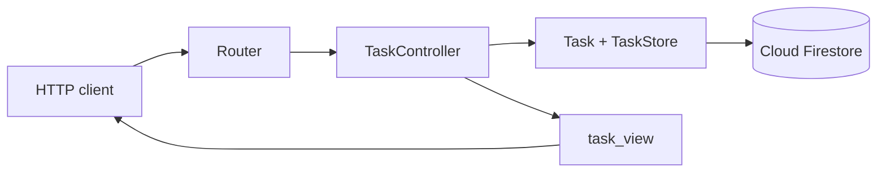

# TODO app with MVC architecture

This project is a small TODO API built to explain **Model–View–Controller
(MVC)**. It can create, list, and complete tasks, and it stores them in Firebase
Cloud Firestore.

## Architecture at a glance

MVC separates three jobs:

- **Model:** holds data, rules, and persistence.
- **Controller:** receives a user action and decides what work to perform.
- **View:** formats the result shown to the user.

The actual flow in this project is:



The router and HTTP server support MVC, but they are not extra MVC letters. They
handle web transport so the Model, View, and Controller can keep focused roles.

## Project map

```text
MVC/
├── models/                 Data, rules, and persistence
│   ├── task.py
│   └── task_store.py
├── controllers/            User actions and request validation
│   ├── task_controller.py
│   └── request_validator.py
├── views/                  Output formatting
│   └── task_view.py
├── web/                    HTTP support
│   ├── router.py
│   ├── middleware.py
│   └── http_server.py
├── firebase/               Firebase SDK setup
│   └── client.py
├── config/                 Environment settings
│   └── settings.py
├── tests/
└── main.py                 Connects everything and starts the app
```

Empty `__init__.py` files only make folders importable Python packages.

## Model: data, rules, and storage

The Model answers: **What is a task, what rules does it follow, and how is it
stored?**

### Task model

[task.py](models/task.py) implements `Task`.

It owns these rules:

- `__post_init__()` checks that the ID is a valid UUID.
- It trims the title and requires 1–120 characters.
- `complete()` sets `completed_at` only the first time it is called.
- `complete()` returns `False` when the task was already complete.

These rules belong in the Model because they must remain true whether a task is
created by HTTP, a script, or a test.

`InvalidTask` is also in [task.py](models/task.py). It means the supplied data
cannot form a valid task.

### Task store

[task_store.py](models/task_store.py) implements `TaskStore`, the persistent side
of the Model.

- `create()` constructs a `Task` and saves it.
- `list_all()` reads Firestore documents and orders unfinished tasks first.
- `complete()` finds a document, calls `Task.complete()`, and saves the change.
- `_save()` maps a `Task` to a Firestore document.
- `_from_snapshot()` maps a Firestore document snapshot back to a `Task`.

`TaskNotFound` lives here because it means the requested stored model does not
exist.

Classic MVC treats persistence as part of the Model side. Keeping `TaskStore`
separate from `Task` still helps: `Task` owns one task’s behavior, while
`TaskStore` owns collection and storage operations.

## Controller: handling actions

The Controller answers: **What should happen for this user action?**

[task_controller.py](controllers/task_controller.py) implements
`TaskController`:

- `create()` validates the input, asks `TaskStore` to create a task, selects
  `task_view()`, and returns HTTP status 201.
- `index()` asks the store for all tasks and selects `task_list_view()`.
- `complete()` passes the task ID to the store and selects `task_view()`.
- `method_not_allowed()` returns a 405 error representation.

The controller does not contain task rules, Firebase document code, or JSON field
mapping. It only coordinates those responsibilities.

### Request validator

[request_validator.py](controllers/request_validator.py) checks the shape of the
create request. `create_task_title()` accepts only an object containing one
string field named `title`.

The validator checks **request shape**. The `Task` model checks **business
validity**. For example, `{"title":""}` has the correct request shape but fails
the Model’s 1–120 character rule.

## View: formatting output

The View answers: **What should the response look like?**

[task_view.py](views/task_view.py) implements three views:

- `task_view()` converts one `Task` into a JSON-ready dictionary.
- `task_list_view()` converts a list of tasks into `{"tasks": [...]}`.
- `error_view()` converts an error message into `{"error": "..."}`.

A View does not have to be an HTML page. This application is a JSON API, so its
views create JSON-ready data. The View reads `Task` objects but does not save or
change them.

## Web support

These files support the MVC flow without taking over Model, View, or Controller
responsibilities:

| File | Simple responsibility | Implemented example |
| --- | --- | --- |
| [router.py](web/router.py) | Match method and URL to a controller action | `POST /tasks` calls `TaskController.create()` |
| [middleware.py](web/middleware.py) | Run behavior shared by every request | `begin_request()` creates and logs a request ID |
| [http_server.py](web/http_server.py) | Read and write HTTP | Parses JSON, maps exceptions to statuses, and adds `X-Request-ID` |

Known invalid input becomes HTTP 400. A missing task becomes 404. Unsupported
methods on a known route become 405. Unknown routes become 404.

## Firebase and configuration

[client.py](firebase/client.py) implements `create_firestore_client()`. It starts
the Firebase Admin SDK once and returns a Cloud Firestore client. SDK startup is
kept out of the Model, View, and Controller.

[settings.py](config/settings.py) reads the Firebase project ID, collection name,
HTTP host, and port from environment variables.

[main.py](main.py) is the **composition root**, meaning the place where concrete
objects are created and connected:

1. Create the Firestore client.
2. Give it to `TaskStore`.
3. Give `TaskStore` to `TaskController`.
4. Give the controller to `Router`.
5. Give the router to the HTTP server.

### Firestore document shape

Firestore has no SQL table schema, but `TaskStore` expects every task document to
have this shape:

```text
tasks/{task UUID}
├── title: string
├── created_at: timestamp
└── completed_at: timestamp or null
```

This mapping is implemented by `_save()` and `_from_snapshot()` in
[task_store.py](models/task_store.py). The `Task` model validates the values when
a document is rebuilt.

## Dependency injection in this project

**Dependency injection** means giving an object the tool it needs instead of
letting it create that tool itself.

Implemented in [main.py](main.py):

```python
client = create_firestore_client(settings.firebase_project_id)
store = TaskStore(client, settings.task_collection)
controller = TaskController(store)
```

`TaskController` receives a `TaskStore`; it does not create one. `TaskStore`
receives a Firestore client; it does not initialize Firebase itself.

The tests use the same idea. [test_mvc_todo.py](tests/test_mvc_todo.py) gives
`TaskStore` an in-memory client from
[fake_firestore.py](tests/fake_firestore.py), a fixed clock, and predictable IDs.

## Loose and tight coupling

**Loose coupling** means a component does not know unnecessary details.
`TaskController` calls `TaskStore` methods but does not know how Firestore
documents work.

**Tight coupling** means a component knows a concrete implementation.
`TaskStore` is intentionally coupled to Firestore’s document API because this
classic MVC Model owns persistence. Firebase setup is still isolated in
`firebase/client.py`.

## SOLID principles in this MVC example

MVC and SOLID are different ideas. MVC chooses Model, View, and Controller
roles; SOLID gives guidance for designing the classes inside those roles.

| Principle | Simple meaning | What the files show |
| --- | --- | --- |
| Single Responsibility | One main reason to change | `Task` owns task rules, `TaskController` owns action flow, and `task_view.py` owns response formatting |
| Open/Closed | Extend behavior with few changes to existing code | A new response function can be added in `task_view.py`, although its controller action must still select it |
| Liskov Substitution | A replacement must keep the expected behavior | `fake_firestore.py` replaces the real Firestore client in tests while keeping the `collection → document → get/set` behavior used by `TaskStore` |
| Interface Segregation | Depend on small focused capabilities | `TaskStore` uses only the small Firestore document operations it needs; no large application-wide interface is introduced |
| Dependency Inversion | High-level flow should depend on abstractions | This small MVC example does this only partly: constructor injection is used, but `TaskController` still names concrete `TaskStore`. The DDD project demonstrates the principle more strongly with `TaskRepository` |

This honest difference is useful: dependency injection can be present without
full dependency inversion. Passing `TaskStore` into `TaskController` is DI;
making the controller depend on an abstract store interface would additionally
apply dependency inversion.

## DTOs in this MVC project

This small MVC version does not use DTOs. The Controller receives `Task` model
objects and passes them directly to the View. You can see that in
[task_controller.py](controllers/task_controller.py), where results from
`TaskStore` go to functions in [task_view.py](views/task_view.py).

DTOs would become useful if the API contract needed to be independent from the
Model, or if several clients required different data shapes. The DDD project
uses DTOs because it has a clear application boundary between domain objects and
presentation.

## Services in this MVC project

There is no generic `services/` folder because the current behavior already has
a precise owner:

- Task rules belong to `Task`.
- Persistence belongs to `TaskStore`.
- Request coordination belongs to `TaskController`.
- Firebase initialization belongs to `firebase/client.py`.

A new service should be added only when it has a clear job that does not fit an
existing component. For example, a vendor email adapter could live in an
`integrations/` folder, while the controller coordinates when to call it.

## Follow one create request

For `POST /tasks` with `{"title":"Learn MVC"}`:

1. [http_server.py](web/http_server.py) reads the JSON body.
2. [router.py](web/router.py) selects `TaskController.create()`.
3. [request_validator.py](controllers/request_validator.py) checks that the body
   contains only a string `title`.
4. [task_controller.py](controllers/task_controller.py) calls
   `TaskStore.create()`.
5. [task_store.py](models/task_store.py) creates `Task`.
6. [task.py](models/task.py) trims and validates the title.
7. `TaskStore._save()` writes the Firestore document.
8. The controller passes the task to `task_view()` in
   [task_view.py](views/task_view.py).
9. The HTTP server encodes the dictionary and returns HTTP 201.

Every step points to an implemented method; there is no hidden framework code.

## Endpoints

| Request | Controller | Model operation | View | Result |
| --- | --- | --- | --- | --- |
| `POST /tasks` | `TaskController.create()` | `TaskStore.create()` | `task_view()` | 201 |
| `GET /tasks` | `TaskController.index()` | `TaskStore.list_all()` | `task_list_view()` | 200 |
| `POST /tasks/{id}/complete` | `TaskController.complete()` | `TaskStore.complete()` | `task_view()` | 200 |

## Run the application

Requirements: Python 3.10+, a Firebase project, and Cloud Firestore enabled.

```sh
cd MVC
python3 -m pip install -r requirements.txt

export GOOGLE_APPLICATION_CREDENTIALS="/secure/path/service-account.json"
export FIREBASE_PROJECT_ID="your-project-id"

python3 main.py
```

Keep the service-account file outside this repository. The Firebase Admin SDK is
trusted server code, so credentials must never be exposed to a browser or
committed to Git.

Optional settings read by [settings.py](config/settings.py):

| Variable | Default | Purpose |
| --- | --- | --- |
| `FIREBASE_PROJECT_ID` | From credentials/environment | Firebase project |
| `FIREBASE_TASK_COLLECTION` | `tasks` | Firestore collection |
| `TODO_HOST` | `127.0.0.1` | HTTP host |
| `TODO_PORT` | `8000` | HTTP port |

For the Firestore emulator, set `FIRESTORE_EMULATOR_HOST`, such as
`127.0.0.1:8080`, and use a safe project ID such as `demo-todo`.

Try the API:

```sh
curl -i -X POST http://127.0.0.1:8000/tasks \
  -H 'Content-Type: application/json' \
  -d '{"title":"Learn MVC"}'

curl -i http://127.0.0.1:8000/tasks

curl -i -X POST http://127.0.0.1:8000/tasks/TASK_ID/complete
```

## Tests

```sh
cd MVC
python3 -m unittest discover -s tests -v
```

[test_mvc_todo.py](tests/test_mvc_todo.py) checks Model rules, request
validation, routing, create/list/complete behavior, repeated completion,
Firestore mapping, and dependency direction. The in-memory
[fake_firestore.py](tests/fake_firestore.py) keeps unit tests independent from a
real Firebase project.

## MVC compared with DDD/onion

MVC and DDD answer different questions:

- **MVC asks:** How do input, application data, actions, and output work
  together?
- **DDD asks:** How should business meaning and business rules be modeled?
- **Onion architecture asks:** Which direction may source dependencies point?

The neighboring [DDD project](../DDD/README.md) combines DDD with onion
architecture.

| Question | This MVC project | DDD/onion project |
| --- | --- | --- |
| Main focus | Input → action → model → output | Business model and inward dependencies |
| Task rule location | `models/task.py` | Domain entity and value objects |
| Workflow | Controller calls `TaskStore` | Application `TaskService` coordinates ports and domain |
| Firebase location | Model-side `TaskStore` uses Firestore | Infrastructure repository implements an application interface |
| Output | View reads `Task` directly | View reads `TaskDTO` |
| Domain event | None | `TaskCompleted` |

MVC is often a good fit for straightforward CRUD and user-interface flow. DDD
and onion architecture become more valuable when business rules and integrations
grow complex. They can also be combined: MVC controllers and views can form the
presentation layer around DDD application services.

## Request and response responsibilities

For an incoming request, the HTTP server parses transport data, the router
selects a controller action, the controller coordinates the Model, and the View
formats the result. The response is initiated by the controller after the Model
operation returns, then the HTTP server serializes the selected View output.

```text
Request:  client -> HTTP server -> router -> controller -> model -> Firestore
Response: Firestore -> model -> controller -> view -> HTTP server -> client
```

The View does not update the database. It only represents the result. The
Controller does not own task rules. It chooses which Model operation and View
belong to the request.

## Where schemas and validation live

| Concern | MVC location | Implemented example |
| --- | --- | --- |
| HTTP request shape | Controller support | `request_validator.py` requires one string `title` |
| Business-valid task state | Model | `Task.__post_init__()` validates UUID and title |
| Firestore document shape | Persistent Model component | `TaskStore._save()` and `_from_snapshot()` |
| JSON response shape | View | `task_view()` and `task_list_view()` |

Firestore creates a document on the first write. There is no SQL-style schema
file that executes before each GET. A GET reads stored fields, then
`TaskStore._from_snapshot()` rebuilds and validates the `Task` model.

## Authentication scope

This MVC teaching example currently demonstrates unauthenticated MVC CRUD. The
neighboring DDD project contains the implemented Firebase Authentication,
automatic Postman login, verified user identity, and owner-scoped tasks. Adding
the same feature here would require authentication middleware and owner-aware
Model queries; sharing the DDD project's service-account file or Firebase client
alone would not authenticate end users.

## Common questions and precise answers

| Question | Answer tied to this project |
| --- | --- |
| What is MVC? | A separation of Model state/rules, Controller action coordination, and View output formatting. |
| What is the Model? | `Task` owns task rules and `TaskStore` owns persistent task operations. |
| What is the Controller? | `TaskController` receives an action, calls the appropriate Model operation, and chooses a View. |
| What is the View? | A formatter that turns Model results into JSON-ready dictionaries. |
| Where does routing belong? | `web/router.py` supports the web interface by mapping method/path pairs to controller actions. |
| Where does the response begin? | The controller receives the Model result and selects a View; the HTTP server then writes it. |
| What is dependency injection? | `main.py` constructs `TaskStore` and passes it to `TaskController`. |
| What is loose coupling here? | The controller uses `TaskStore` methods without knowing Firestore document operations. |
| Where is tight coupling? | `TaskStore` directly uses Firestore because persistence is part of this MVC Model side. |
| Does this MVC project use DTOs? | No; the View receives `Task` directly, as explained in the DTO section above. |
| Is every service infrastructure? | No; placement follows responsibility, although this small MVC project needs no generic service layer. |
| When is a Firestore document created? | When `TaskStore._save()` performs a write for a new task. |
| Does GET recreate the schema? | No; it reads a document and maps it back into a validated `Task`. |
| How is MVC different from DDD? | MVC organizes input/actions/output; DDD models business language and rules; onion architecture controls dependency direction. |
